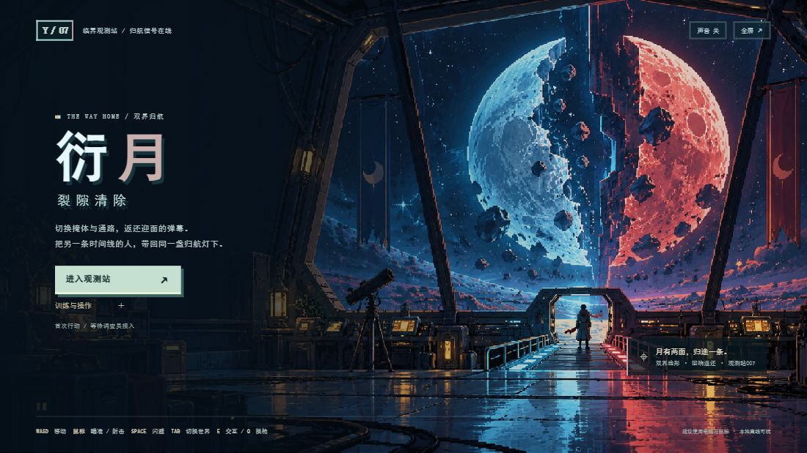
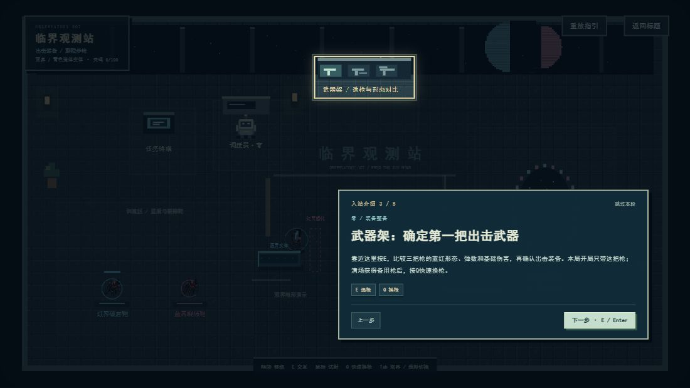
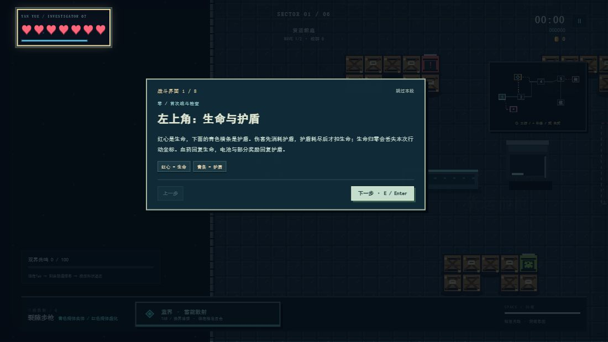

# 衍月 · 裂隙清除

以双世界切换为核心的 2D 像素射击游戏。玩家从临界观测站出发，在红蓝时间线之间改变武器、实体掩体与通路，营救被困同伴，突破坍缩守卫的封锁。

## 快速运行

- 下载本仓库后，保持文件结构，使用桌面版 Edge 或 Chrome 打开 `index.html`。
- 也可从 [Release](../../releases/latest) 下载离线包，解压后打开其中的离线单文件 HTML。
- 不需要安装依赖、登录、API 密钥或联网。推荐键盘与鼠标，声音在首次点击后启用。

## 操作

| 按键 | 功能 |
| --- | --- |
| WASD / 方向键 | 移动 |
| 鼠标 / 按住左键 | 瞄准 / 连续射击 |
| Tab | 切换双界，改变武器与地形；临危精准切换可返还普通弹幕 |
| Space | 闪避 |
| E | 交互 |
| Q | 获得备用枪后切换枪械 |
| Esc | 暂停 |

## 核心内容

- **双界地形**：同色相位掩体实体化，异色虚化；改变通路、弹道与激光遮挡。
- **回响反击**：敌弹即将命中时精准换界，刻录点状或条状普通弹，并反向返还。
- **射击与成长**：三把枪的不同形态、局内人物与武器强化、金币补给、生命上限交易。
- **相连战区**：五处主线战区、九轮战斗，另有工坊救援支线及交易小房间；实体通道连接，清场后解除门禁。
- **Boss 演出**：坍缩守卫属于闭源型，包含出场、三阶段攻击、战败演出与归航尾声。
- **首次引导**：大厅功能区与战斗 HUD 逐步高亮，阅读期间暂停战斗，可跳过或重看。

## 提交与演示资料

- [一页项目说明 PDF](docs/项目说明.pdf)
- [运行与开发说明](docs/运行与开发说明.md)
- [归航剧情与引导说明](docs/归航剧情与引导说明.md)
- [Release 离线包与 MP4 实机视频](../../releases/latest)

演示视频为游戏运行画面的分段功能演示。为集中呈现机制，使用演示状态布置场景、切换章节与触发 Boss 技能；不是连续通关录像。

## 技术与 AI 使用

HTML5 Canvas、原生 JavaScript、CSS 与 WebAudio，无第三方运行库。Codex 辅助设计、编码与验证；ImageGen 生成场景与静态精灵，动画反馈由程序实现；声音由 WebAudio 实时合成，核心玩法不调用在线模型。

AI 美术提示词及生成记录见 `assets/` 下的说明文档。

## 项目范围

当前为固定地图的单机比赛原型，无联机或局外养成。机制与流程已有检查，平衡和手感仍可继续打磨。
